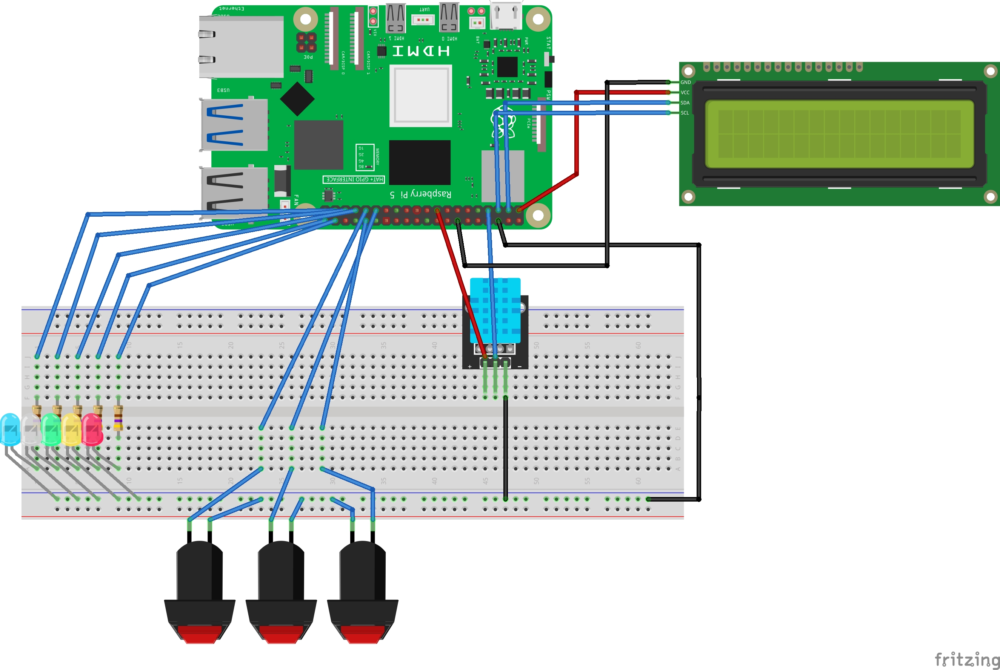

# Raspberry Pi 温湿度モニター

DHT11・SSD1306 OLED・5色LED・3つの物理スイッチ・Flask を使用した、Raspberry Pi 向け温湿度モニタリングシステムです。

**Features:** local dashboard, real-time temperature/humidity readings, 30-minute trend chart, OLED display, LED alerts, and physical-button comfort-range adjustment.

## 機能

- **DHT11**：通常モードで約5秒ごとに温度・湿度を取得
- **SSD1306 OLED（128×64 / I2C）**：現在値、状態アイコン、設定画面を表示
- **5色LED**：暑い・寒い・乾燥・多湿・快適の状態を表示。温度と湿度が両方範囲外の場合は2色同時点灯
- **3つの物理スイッチ**：快適範囲を変更。操作が5秒間なければ通常モードへ戻る
- **Flask ダッシュボード**：LAN内のブラウザで温湿度とグラフを確認（2秒ごとに画面更新）
- **時系列データ**：最大360件をメモリに保持（約30分）

## プロジェクト構成

```text
rpi-temperature-humidity-monitor/
├── run.py                      # 起動スクリプト
├── requirements.txt            # Python依存ライブラリ
├── README.md
├── circuit-diagram.jpg         # 配線参考図
├── .gitignore
├── .github/workflows/tests.yml  # GitHub Actions（PC上で実行できるテスト）
├── climate_monitor/
│   ├── __init__.py
│   ├── config.py                # GPIOピン・初期設定・更新間隔
│   ├── main.py                  # 全体の起動・測定ループ・終了処理
│   ├── sensor.py                # DHT11
│   ├── display.py               # SSD1306 OLED表示
│   ├── _drawing.py              # OLEDアイコンの描画関数
│   ├── leds.py                  # LED出力
│   ├── buttons.py               # スイッチと設定画面
│   ├── settings.py              # 快適範囲（スレッド間共有）
│   ├── logic.py                 # 温湿度判定ロジック
│   ├── state.py                 # 測定結果・履歴（メモリ保存）
│   ├── web.py                   # FlaskルートとAPI
│   ├── templates/
│   │   └── index.html
│   └── static/
│       ├── style.css
│       └── app.js
└── tests/
    ├── test_logic.py
    ├── test_state.py
    ├── test_buttons.py
    ├── test_leds.py
    └── test_web.py
```

## 使用ハードウェア

以下は **BCM GPIO番号** です。電源・GNDはデバイスの仕様に合わせて配線してください。

| デバイス | BCM GPIO | 物理ピン | 備考 |
|---|---:|---:|---|
| DHT11 DATA | 4 | 7 | センサーの仕様に従いプルアップを使用 |
| OLED SDA | 2 | 3 | I2C |
| OLED SCL | 3 | 5 | I2C |
| 青色LED | 26 | 37 | 低温 |
| 白色LED | 19 | 35 | 乾燥 |
| 緑色LED | 13 | 33 | 快適 |
| 黄色LED | 21 | 40 | 多湿 |
| 赤色LED | 20 | 38 | 高温 |
| スイッチ1 | 6 | 31 | 項目切替 |
| スイッチ2 | 5 | 29 | 値を +1 |
| スイッチ3 | 12 | 32 | 値を -1 |

- LEDには適切な**電流制限抵抗**を使用してください。
- スイッチは内部プルアップ（`PUD_UP`）を使い、押すとGNDに接続される配線です。
- OLEDのI2Cアドレス `0x3C` / `0x3D` を自動検出します。
- 実際に使用するRaspberry Piのモデルに合わせて、GPIOライブラリの対応状況を確認してください（特にRaspberry Pi 5）。

## 配線図



図はLCDを使用した構成の参考図です。本プロジェクトの表示処理はSSD1306 OLED向けのため、表示器の接続は使用するモジュールの仕様と上記のGPIO表を確認してください。

## インストールと起動

Raspberry Pi OS と Python 3.9 以降を想定しています。Raspberry Piで以下を実行してください。

```bash
sudo raspi-config
```

`Interface Options` → `I2C` を有効にします。

```bash
sudo apt update
sudo apt install -y python3-venv python3-dev fonts-noto-cjk libgpiod2

git clone https://github.com/YOUR_USERNAME/rpi-temperature-humidity-monitor.git
cd rpi-temperature-humidity-monitor

python3 -m venv --system-site-packages .venv
source .venv/bin/activate
python -m pip install -r requirements.txt
python run.py
```

> `YOUR_USERNAME` はGitHubに公開したあとの自分のユーザー名に置き換えてください。ZIPで転送した場合は `git clone` の行を省略できます。Raspberry Pi OSのバージョンによっては `libgpiod2` などのパッケージ名が異なる場合があります。

起動ログに出るURL（例：`http://192.168.1.50:5000`）を**同じLAN内**のPC・スマートフォンのブラウザで開きます。終了する場合は `Ctrl+C` を押します。

### 初期設定

`climate_monitor/config.py` で変更できます。

| 設定 | 初期値 |
|---|---|
| 快適温度 | 20〜25℃ |
| 快適湿度 | 45〜60% |
| 測定周期 | 5秒 |
| 履歴件数 | 360件（メモリ上のみ） |
| Flaskポート | 5000 |

スイッチ1を押すたびに **最大温度 → 最小温度 → 最大湿度 → 最小湿度 → 通常モード** の順で切り替わります。スイッチ2で+1、スイッチ3で-1です。

## API

| GET | 内容 |
|---|---|
| `/` | ブラウザ用ダッシュボード |
| `/api/status` | 最新の温湿度、状態、最終更新時刻、快適範囲 |
| `/api/history` | 最新360件以内の時系列データ |

読み取り専用です。認証機能はありません。**ポート5000をインターネットへ公開しないでください。**

## テスト

温湿度判定・履歴件数・Flask APIは、Raspberry Piに接続せずPC/Macでもテストできます（Flaskをインストールする必要があります）。

```bash
python -m pip install Flask
python -m unittest discover -s tests -v
```

GitHub Actionsでは、ハードウェアを使わないテストを自動実行します。実際のOLED表示・DHT11読み取り・GPIO割り込みは、Raspberry Pi実機での動作確認が必要です。

## 制限・メモ

- 設定値と履歴データはメモリ上だけに保存し、再起動時にリセットされます。
- OLEDで快適範囲を編集している間は、新しい温湿度サンプルの取得を一時停止します（元の実装を踏襲）。
- DHT11で一時的に値を取得できなかった場合は次回サイクルで再試行します。
- Raspberry Pi 5など、標準 `RPi.GPIO` が動作しない環境では対応ライブラリへの変更が必要になる場合があります。
- このリポジトリは既存の単一ファイル版を機能別に整理したリファクタリング版です。
